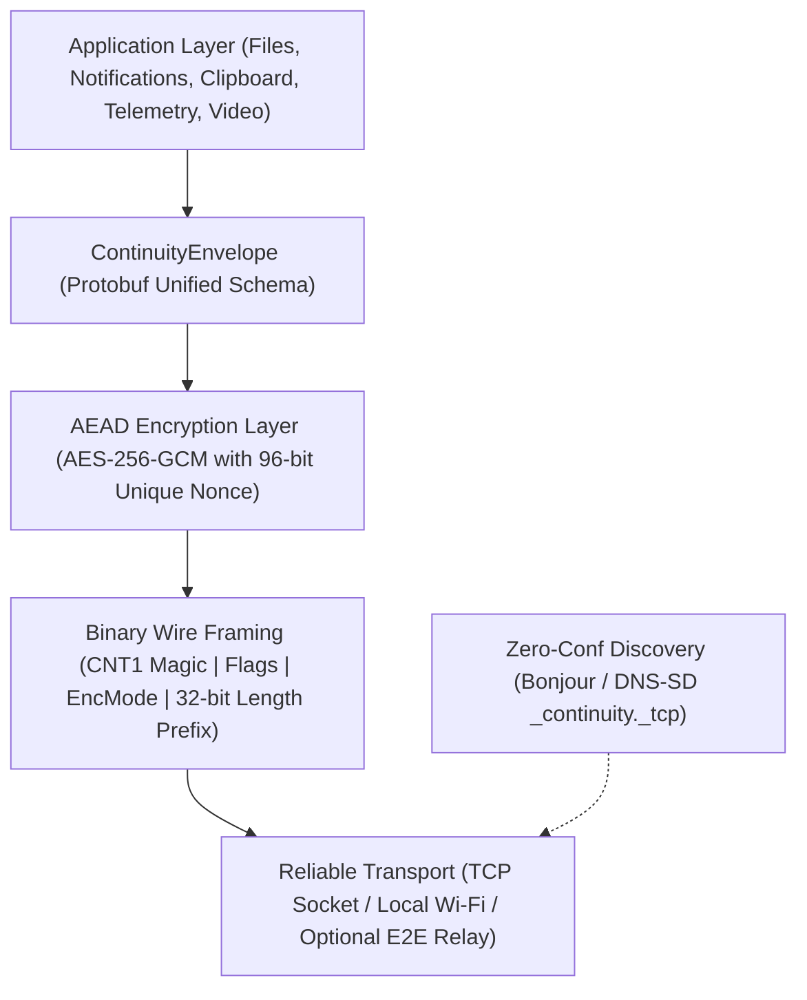
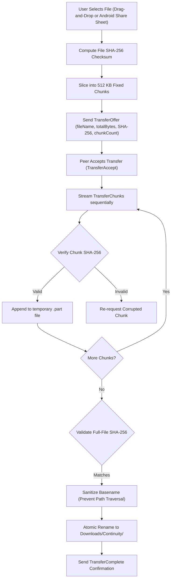
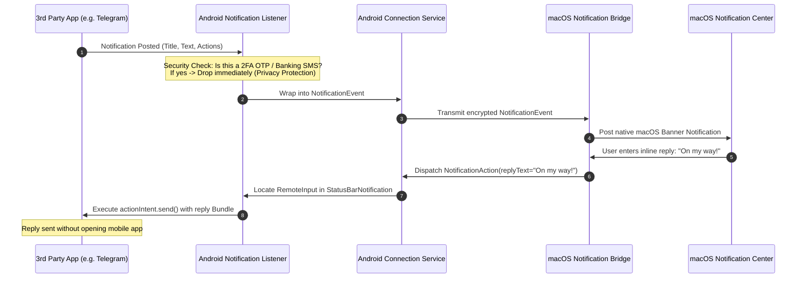

# Android + macOS Continuity Ecosystem

[](.github/workflows/ci.yml)
[](shared/protocol/schemas/continuity_protocol.proto)
[-black.svg?logo=apple)](apps/macos)
[-green.svg?logo=android)](apps/android)
[](shared/crypto-spec/spec.md)
[](LICENSE)

An industrial-grade, cross-platform ecosystem uniting Android smartphones and macOS desktops into a unified, seamless workspace. Emulating the intuitive experience of Apple's Continuity while unlocking Android's flexible hardware capabilities, this platform delivers **zero-configuration device pairing, high-throughput bidirectional file transfers, encrypted clipboard synchronization, notification forwarding with inline remote replies, sub-35ms display mirroring, phone-as-webcam streaming (CoreMediaIO), and automated incremental photo backup.**

The ecosystem is engineered around a **local-first, zero-knowledge security architecture**: all communications operate directly peer-to-peer over your local network without accounts, cloud subscriptions, or telemetry tracking.

---

## 📑 Table of Contents

1. [Product Vision & Philosophy](#-product-vision--philosophy)
2. [Ecosystem Architecture](#-ecosystem-architecture)
   - [Logical System Topology](#logical-system-topology)
   - [Protocol & Networking Stack](#protocol--networking-stack)
   - [Zero-Trust Security & Key Agreement Sequence](#zero-trust-security--key-agreement-sequence)
   - [Bidirectional File Transfer Pipeline](#bidirectional-file-transfer-pipeline)
   - [Notification Mirroring & Inline Reply Workflow](#notification-mirroring--inline-reply-workflow)
3. [Two Product Editions](#-two-product-editions)
4. [Exhaustive Feature Catalog](#-exhaustive-feature-catalog)
5. [Repository Structure](#-repository-structure)
6. [Building & Running](#-building--running)
   - [Prerequisites](#prerequisites)
   - [Building macOS Desktop Companion](#1-building-the-macos-companion)
   - [Building Android Application](#2-building-the-android-app)
   - [Running Verification Test Suites](#3-running-verification-test-suites)
   - [Connecting via ADB for Live Device Testing](#4-testing-on-a-physical-android-device-via-adb)
7. [Security & Cryptographic Specification](#-security--cryptographic-specification)
8. [Platform Constraints & Compliance](#-platform-constraints--compliance)
9. [Troubleshooting & FAQ](#-troubleshooting--faq)

---

## 🎯 Product Vision & Philosophy

Apple's native Continuity features (AirDrop, Universal Clipboard, Notification Center, iPhone Mirroring, Continuity Camera) offer seamless cross-device workflows, but restrict users exclusively to iPhones and Macs. Android users owning Macs have historically been forced into fragmented workarounds, unreliable MTP drivers, or privacy-invasive third-party cloud servers.

This project delivers:
- **Native Platform Idioms**: Swift 6 and SwiftUI on macOS; Kotlin and Jetpack Compose (Material 3) on Android.
- **Zero Cloud Dependence**: Operates 100% locally on your Wi-Fi subnet; zero external internet access required for core functionality.
- **Privacy by Design**: End-to-end encrypted transport (AES-256-GCM) with visual out-of-band SAS PIN verification and local hardware Keystore / Keychain key management.
- **Frictionless Consumer Setup**: Public Edition requires no ADB, root, or command-line developer tools.
- **Power-User Extensibility**: Advanced Personal Edition harnesses bundled `scrcpy` and ADB tunnels for ultra-low latency mirroring (< 35ms) and automation.

---

## 🏗️ Ecosystem Architecture

### Logical System Topology

```
┌────────────────────────────────────────────────────────┐       ┌────────────────────────────────────────────────────────┐
│                   macOS Companion                      │       │                  Android Mobile App                    │
│                                                        │       │                                                        │
│  ┌──────────────────────────────────────────────────┐  │       │  ┌──────────────────────────────────────────────────┐  │
│  │             SwiftUI Desktop Dashboard            │  │       │  │           Jetpack Compose UI (Material 3)        │  │
│  │   • Dashboard HUD      • Transfers View          │  │       │  │   • Home Status Card   • QR Scanner Dialog      │  │
│  │   • Notifications View • Screen Mirroring Canvas │  │       │  │   • Transfers Screen   • Notification Toggles   │  │
│  │   • Camera View        • Backup & Sync Settings  │  │       │  │   • Privacy Settings   • Mirroring Consent View │  │
│  └──────────────────────────┬───────────────────────┘  │       │  └──────────────────────────┬───────────────────────┘  │
│                             │                          │       │                             │                          │
│  ┌──────────────────────────▼───────────────────────┐  │       │  ┌──────────────────────────▼───────────────────────┐  │
│  │                 Core Application Engines         │  │       │  │               Platform Background Services       │  │
│  │   • FileTransferEngine   (512KB Chunks & Resume) │  │       │  │   • FileTransferManager (Storage Access Framewk) │  │
│  │   • NotificationBridge   (macOS UserNotifications│  │       │  │   • ContinuityNotificationListener (2FA Filter)  │  │
│  │   • ClipboardBridge      (NSPasteboard Privacy)  │  │       │  │   • ClipboardSyncManager (Foreground / QuickSet) │  │
│  │   • DeviceRegistry       (Keychain Credentials)  │  │       │  │   • ScreenShareService  (MediaProjection & AVC)  │  │
│  │   • AdvancedHostManager  (ADB & scrcpy Controller│  │       │  │   • CameraStreamingService (CameraX Stream)      │  │
│  │   • CoreMediaIO Extension(Virtual Webcam Sink)   │  │       │  │   • PhotoBackupWorker   (WorkManager Scheduler)  │  │
│  └──────────────────────────┬───────────────────────┘  │       │  └──────────────────────────┬───────────────────────┘  │
│                             │                          │       │                             │                          │
│  ┌──────────────────────────▼───────────────────────┐  │       │  ┌──────────────────────────▼───────────────────────┐  │
│  │                ContinuityProtocol Engine         │  │       │  │                 ContinuityCore Engine            │  │
│  │   • FrameEncoder / FrameDecoder (CNT1 Wire Spec) │  │       │  │   • ProtocolFraming Stream Decoder (readFully)   │  │
│  │   • Envelope Serialization (Protobuf Models)     │  │       │  │   • ContinuityEnvelope Serializer (Gson/Proto)   │  │
│  │   • CryptoManager (Apple CryptoKit ECDH / AES-GCM│  │       │  │   • DeviceIdentity (Android KeyStore & JCE)      │  │
│  └──────────────────────────┬───────────────────────┘  │       │  └──────────────────────────┬───────────────────────┘  │
│                             │                          │       │                             │                          │
│  ┌──────────────────────────▼───────────────────────┐  │       │  ┌──────────────────────────▼───────────────────────┐  │
│  │             Network.framework Transport          │  │       │  │               Android Java NIO / NSD Sockets     │  │
│  │   • NWListener (TCP Port 52400)                  │  │       │  │   • NsdManager (DNS-SD _continuity._tcp)         │  │
│  │   • NWBrowser  (Bonjour _continuity._tcp)        │  │       │  │   • Managed Foreground ConnectionService Socket  │  │
│  └──────────────────────────┬───────────────────────┘  │       │  └──────────────────────────┬───────────────────────┘  │
└─────────────────────────────┼──────────────────────────┘       └─────────────────────────────┼──────────────────────────┘
                              │                                                                │
                              └═══════════════ Mutually Authenticated Local Socket ════════════┘
                                               Bonjour Service: _continuity._tcp
                                               Framing: CNT1 Big-Endian Length-Prefixed
                                               Payload Encryption: AES-256-GCM
```

---

### Protocol & Networking Stack

Every message in the continuity ecosystem is multiplexed over a framed, encrypted TCP connection:



---

### Zero-Trust Security & Key Agreement Sequence

Devices authenticate with an ephemeral out-of-band PIN verification handshake. Even on untrusted public Wi-Fi, passive eavesdroppers or rogue peers cannot decrypt or tamper with session data:

```mermaid
sequenceDiagram
    autonumber
    participant Mac as macOS Companion
    participant Android as Android Phone

    Note over Mac: 1. Generate Ephemeral KeyPair (pkA, skA)<br>Generate 6-digit Visual PIN (e.g. 849201)
    Mac->>Mac: Render QR Code (host, port, pkA, PIN, exp)
    Note over Android: 2. Scan QR Code via CameraX<br>Generate Ephemeral KeyPair (pkB, skB)
    Android->>Mac: TCP Connect to Host:Port
    Android->>Mac: PairRequest(deviceId, pkB, PIN)
    Note over Mac: 3. Verify PIN matches active session<br>Compute SharedSecret = ECDH(skA, pkB)<br>Derive SessionKey = HKDF(SharedSecret, Salt=PIN)<br>Compute AuthTag = HMAC(SessionKey, deviceId)
    Mac->>Android: PairConfirm(approved=true, sessionToken, AuthTag, pkA)
    Note over Android: 4. Compute SharedSecret = ECDH(skB, pkA)<br>Derive SessionKey = HKDF(SharedSecret, Salt=PIN)<br>Validate AuthTag with SessionKey
    Note over Mac,Android: 5. Session Authenticated (AEAD AES-256-GCM Active)
    Android->>Mac: DeviceHello(model="Pixel 9 Pro", OS="Android 15")
    Mac->>Android: CapabilityList(supportsFiles=true, supportsMirror=true)
    Note over Mac,Android: 6. Sockets Established; Telemetry & Multiplexed I/O Active
```

---

### Bidirectional File Transfer Pipeline

Designed to replicate AirDrop throughput with zero size limitations, chunked integrity verification, and automatic resume support:



---

### Notification Mirroring & Inline Reply Workflow



---

## 📦 Two Product Editions

The ecosystem maintains one modular codebase partitioned into two editions to respect Google Play policies while providing unrestricted power-user capabilities:

| Dimension | Public Edition | Advanced Personal Edition |
| :--- | :--- | :--- |
| **Audience** | General consumers | Power users, developers, enthusiasts |
| **Android Distribution** | Google Play Store (`.aab`) | Direct APK installation / GitHub Releases |
| **macOS Distribution** | Developer ID signed & notarized `.dmg` | Same companion app + optional background helper daemon |
| **System Prerequisites** | Zero. No developer options, ADB, or terminal commands | USB Debugging or Wireless ADB enabled |
| **Screen Mirroring** | Android `MediaProjection` API (user consent dialog) | Bundled `scrcpy` over USB/TCP (< 35ms latency, 60fps) |
| **Remote Control** | Read-only status & notification replies | Direct injection of keyboard, mouse, and hardware navigation |
| **Clipboard Sync** | User-triggered explicit push & Quick Settings tile | Seamless continuous background synchronization |
| **Google Play Compliance**| 100% policy compliant; zero restricted permissions | Independent developer build |

---

## 🌟 Exhaustive Feature Catalog

### 1. Pairing & Identity Management
- **Automatic Bonjour Discovery**: Seamless mDNS discovery on `_continuity._tcp`.
- **Dynamic QR Pairing**: Generates pairing payloads containing real host IPv4, port, ephemeral public key, and 6-digit visual PIN.
- **Mutual Key Exchange**: Ephemeral ECDH (NIST P-256) with HKDF-SHA256 session key derivation.
- **Cryptographic Trust Store**: Device credentials persisted securely in **Apple Keychain** (`kSecClassGenericPassword`) and **Android KeyStore** (hardware-backed TEE / StrongBox).
- **Session Reconnection**: Automatic encrypted re-establishment using cached session tokens.
- **Immediate Trust Revocation**: One-click unpairing invalidates cached session tokens and drops unauthorized connection attempts immediately.

### 2. High-Throughput File Transfer (Line-Rate Optimized)
- **AirDrop Equivalence**: Send any file, document, or photo from Mac to Android or Android to Mac with zero cloud dependency.
- **Raw Binary Wire Streaming (CNT1 Flag `0x01`)**: Eliminates Base64 encoding and JSON metadata overhead for chunks, reducing network payload size by 33% and preventing GC allocation spikes on both JVM and Swift runtimes.
- **Adaptive Dynamic Chunk Sizing**: Automatically scales chunk sizes based on file volume:
  - *Small Files (< 5 MB)*: 256 KB chunks for low-latency transmission.
  - *Medium Files (5 MB – 50 MB)*: 1 MB chunks.
  - *Large Files & USB (> 50 MB)*: 4 MB chunks to minimize protocol header overhead (under 0.001%).
- **High-Speed Socket Buffer Tuning**: 4 MB TCP send and receive buffers (`SO_SNDBUF` / `SO_RCVBUF`) with `TCP_NODELAY` enabled to saturate 5GHz/6GHz Wi-Fi and high Bandwidth-Delay Product (BDP) links.
- **Automatic USB-C ADB Fast-Path**: When an Android device is connected via USB cable, the companion automatically establishes `adb reverse tcp:52400 tcp:52400`, switching transport to ultra-fast USB 3.0/3.2 loopback (300–450+ MB/s).
- **System Share Sheet Integration**: Registered as an Android system-wide share destination for images, video, text, and documents.
- **SHA-256 Merkle Verification**: Individual chunk validation and total reassembled file hash verification.
- **Path Traversal Protection**: Basename extraction prevents directory traversal attacks (e.g. `../../etc/passwd`).
- **Filename Collision Resolver**: Automatically appends sequential counters (`file (1).ext`) to prevent accidental overwrites.
- **Finder Integration**: Dedicated "Show in Finder" action upon transfer completion.

### 3. Smart Clipboard Synchronization
- **One-Tap Push to Peer**: Send current Mac clipboard to phone or phone clipboard to Mac.
- **Android 10+ Background Restriction Compliance**: Uses explicit user interactions (Quick Settings Tile / Share Sheet) rather than prohibited background polling.
- **Sensitive Content Shield**: Detects password managers and hidden types (`org.nspasteboard.TransientType`, `org.nspasteboard.ConcealedType`) to prevent accidental leakage of master passwords.
- **Multi-Format Support**: UTF-8 plain text, URLs, and image data.

### 4. Notification Mirroring & Interactive Replies
- **Real-Time Notification Forwarding**: Android status bar notifications mirrored to macOS Notification Center.
- **Inline RemoteInput Replies**: Type responses in macOS banners or the Companion dashboard and dispatch replies directly into chat apps (Telegram, Signal, WhatsApp).
- **Automated OTP / 2FA Redaction**: Privacy heuristics automatically block banking SMS, one-time passwords, and verification codes from transmitting over the network.
- **Notification Dismissal**: Dismissing a notification on macOS can sync to Android to keep the status bar tidy.

### 5. Hardware Telemetry & Battery HUD
- **Real-Time Battery HUD**: Displays phone battery percentage and charging indicator in macOS Menu Bar Extra.
- **Wi-Fi Telemetry**: Reports phone Wi-Fi SSID and signal status.
- **Storage Metrics**: Reports Android internal storage availability (Free / Total bytes).

### 6. Screen Mirroring & Hardware Remote Control
- **Public Screen Share**: User-approved Android `MediaProjection` capturing screen to hardware H.264 `MediaCodec`.
- **macOS Display Canvas**: Real-time rendering canvas inside the Companion window.
- **Interactive Navigation Bar**: Dedicated toolbar buttons for Android system controls: **Back (◁), Home (○), Recents (□), Power (⏻), Volume Up, and Volume Down**.
- **Resolution Adapters**: Negotiable 1080p and 720p streams.
- **Advanced scrcpy Harness**: One-click launcher for `scrcpy` over USB or Wi-Fi TCP/IP providing 60fps low-latency control for power users.

### 7. Continuity Camera (CoreMediaIO)
- **High-Definition Webcam**: Turns your Android smartphone into a 1080p / 720p 30fps webcam for Mac apps.
- **CoreMediaIO Virtual Camera**: Directly selectable inside FaceTime, Zoom, Google Meet, OBS, and Teams.
- **Remote Camera Controls**: Switch between Ultra-Wide / Rear camera and Front selfie camera, and toggle the camera LED torch remotely from Mac.

### 8. Incremental Media Backup & Folder Sync
- **Non-Destructive Backup**: Android `WorkManager` background job copies new photos/videos to Mac without deleting phone originals.
- **Intelligent Constraints**: Configurable rules to sync strictly when connected to Wi-Fi and plugged into a charger.
- **Target Mac Directory**: Easily customizable destination folder (defaults to `~/Pictures/ContinuityBackup`).

### 9. Optional E2E Encrypted Relay Service
- **Remote Subnet Traversal**: Lightweight asynchronous Python relay allowing paired devices to communicate when not on the same local Wi-Fi.
- **Zero-Knowledge Architecture**: Relay server forwards opaque encrypted frames without knowing encryption keys.

---

## 📂 Repository Structure

```
android-mac-continuity/
├── Makefile                      # Convenient build, test, and run automation
├── README.md                     # Comprehensive product guide & architecture manual
├── .github/
│   └── workflows/
│       └── ci.yml                # Automated CI pipeline for macOS, Android & integration tests
│
├── apps/
│   ├── macos/                    # Native macOS Desktop & MenuBar Application
│   │   ├── Package.swift         # Multi-target Swift package definition
│   │   ├── Sources/
│   │   │   ├── ContinuityProtocol/ # Wire framing, cryptographic primitives, and Network.framework
│   │   │   │   ├── Models/       # Type-safe Swift protocol models
│   │   │   │   ├── Protocol/     # Binary frame encoder/decoder (CNT1 magic)
│   │   │   │   ├── Crypto/       # CryptoKit ECDH P-256, HKDF, AES-256-GCM
│   │   │   │   └── Network/      # NWListener, NWConnection, and Bonjour advertising
│   │   │   │
│   │   │   ├── ContinuityCompanion/ # SwiftUI macOS Application
│   │   │   │   ├── CompanionApp.swift # @main SwiftUI entry point
│   │   │   │   ├── Views/        # Dashboard, Transfers, Notifications, Mirroring, Camera, Devices, Settings
│   │   │   │   ├── MenuBar/      # MenuBarController & status drop zone
│   │   │   │   ├── FileTransfer/ # FileTransferEngine (chunks, resume, SHA-256)
│   │   │   │   ├── NotificationBridge/ # UserNotifications & RemoteInput dispatcher
│   │   │   │   ├── ClipboardBridge/    # NSPasteboard watcher & sensitive filter
│   │   │   │   ├── ConnectionAgent/    # Local network session orchestrator
│   │   │   │   ├── DeviceRegistry/     # Paired devices & trust management
│   │   │   │   └── AdvancedHost/       # ADB & scrcpy power-user harness
│   │   │   │
│   │   │   └── ContinuityCLI/    # Headless test harness, simulator, and listener
│   │   │       └── main.swift
│   │   │
│   │   └── Tests/
│   │       └── ContinuityTests/  # Swift unit test suite
│   │
│   └── android/                  # Android Mobile Application
│       ├── build.gradle.kts      # Project build configuration
│       ├── settings.gradle.kts   # Module settings
│       ├── gradle.properties     # JVM & AndroidX optimization flags
│       ├── gradlew / gradlew.bat # Official Gradle wrapper scripts
│       ├── gradle/wrapper/       # Gradle wrapper configuration & distribution jar
│       └── app/
│           ├── build.gradle.kts  # Target SDK 35, Jetpack Compose, CameraX, WorkManager
│           └── src/
│               ├── main/
│               │   ├── AndroidManifest.xml # Permissions & foreground service declarations
│               │   ├── java/com/continuity/ecosystem/
│               │   │   ├── MainActivity.kt # Compose navigation & system share sheet handler
│               │   │   ├── core/           # Protocol models, DeviceIdentity (Android KeyStore, ECDH)
│               │   │   ├── connection/     # NetworkDiscovery (NSD mDNS), ConnectionService, ProtocolFraming
│               │   │   ├── pairing/        # PairingManager (QR parsing, auth verification)
│               │   │   ├── files/          # FileTransferManager (SAF ContentResolver, chunking)
│               │   │   ├── clipboard/      # ClipboardSyncManager (Safe pasteboard access)
│               │   │   ├── notifications/  # ContinuityNotificationListenerService & RemoteInput
│               │   │   ├── mirroring/      # ScreenShareService (MediaProjection & MediaCodec H.264)
│               │   │   ├── camera/         # CameraStreamingService (CameraX hardware video)
│               │   │   ├── sync/           # PhotoBackupWorker (WorkManager background sync)
│               │   │   └── ui/             # Modern Material 3 Jetpack Compose theme & screens
│               │   └── res/                # XML resources, strings, colors, data extraction rules
│               │
│               └── test/java/com/continuity/ecosystem/ # Android Unit Test Suite
│                   ├── connection/ProtocolFramingTest.kt # Wire framing & sliced TCP reassembly
│                   ├── core/DeviceIdentityTest.kt        # ECDH, HKDF, AES-GCM, and SHA-256 digests
│                   ├── pairing/PairingManagerTest.kt     # QR URI parsing & parameter validation
│                   ├── files/FileTransferTest.kt         # Chunk math & path traversal sanitization
│                   └── notifications/NotificationFilterTest.kt # OTP & sensitive 2FA redaction
│
├── shared/
│   ├── protocol/
│   │   ├── schemas/continuity_protocol.proto # Wire protocol definition
│   │   ├── capabilities/features.json        # Machine-readable feature catalog
│   │   └── fixtures/sample_envelopes.json    # Compliance test vectors
│   └── crypto-spec/spec.md                   # Cryptographic specification & security proofs
│
├── services/
│   └── optional-relay/relay_server.py        # Asynchronous E2E encrypted WebSocket relay
│
├── tests/
│   ├── android/run_android_tests.py          # Standalone automated Android unit test runner
│   └── integration/run_e2e_test.py           # Sprint 1 End-to-End acceptance test suite
│
└── docs/
    ├── product-requirements.md   # Comprehensive PRD
    ├── system-architecture.md    # System architecture specification
    ├── permissions-matrix.md     # Granular Android & macOS permissions matrix
    ├── security-threat-model.md  # STRIDE threat model & mitigations
    ├── api-protocol.md           # Wire protocol documentation
    ├── testing-plan.md           # Multi-device hardware test plan
    ├── release-checklist.md      # Google Play & Apple notarization checklist
    └── manual-code-checkout.md   # Subsystem audit report & applied quality fixes
```

---

## 🛠️ Building & Running

### Prerequisites

| Tool | Minimum Version | Notes |
| :--- | :--- | :--- |
| **macOS** | macOS 14.0+ (Sonoma / Sequoia) | Apple Silicon (M1–M4) or Intel x86_64 |
| **Swift** | Swift 5.9+ / Xcode 15+ | Built-in via Apple Command Line Tools |
| **Android SDK**| API 35 (Android 15) | Located at `~/Library/Android/sdk` |
| **Java JDK** | OpenJDK 17+ | Required for Android build tools |
| **Python** | Python 3.10+ | Required for test runners and relay |
| **ADB** (Optional)| Homebrew / Android SDK | Required for Advanced Edition & USB testing |

---

### 1. Building the macOS Companion

To compile both the native SwiftUI desktop application and the CLI developer harness:

```bash
# Build both executable targets:
make build-macos
```

The resulting binaries are located in:
- `apps/macos/.build/debug/ContinuityCompanion` (Desktop App)
- `apps/macos/.build/debug/ContinuityCLI` (CLI & Test Harness)

To launch the macOS Companion application:
```bash
make run-companion
```

---

### 2. Building the Android App

The Android application is built using the included Gradle wrapper and configured for Android 15 (compileSdk 35, targetSdk 35, minSdk 26):

```bash
# Build the debug APK using the official Gradle wrapper:
cd apps/android
./gradlew assembleDebug
```

The compiled package will be located at:
`apps/android/app/build/outputs/apk/debug/app-debug.apk`

---

### 3. Running Verification Test Suites

You can execute the entire suite of automated unit, logic, cryptographic, and end-to-end integration tests using one command:

```bash
make all
```

This runs:
1. **macOS Target Builds**: Compiles `ContinuityCompanion` and `ContinuityCLI`.
2. **Swift Protocol Tests (`make test-macos`)**:
   - `[PASS]` Binary framing round-trip encode/decode (`CNT1` 12-byte header).
   - `[PASS]` Ephemeral ECDH P-256 + HKDF key agreement with HMAC-SHA256 auth tag.
   - `[PASS]` SHA-256 integrity checksum verification.
   - `[PASS]` Complex `TransferOffer` payload serialization.
3. **Android Unit & Logic Tests (`make test-android`)**:
   - `[PASS]` 26 test assertions covering binary framing, fragmented TCP stream assembly (`readFully`), ECDH key agreement, AES-256-GCM encryption/decryption, QR parsing, chunk math, path traversal defense, and OTP filtering.
4. **End-to-End Integration Tests (`make test-e2e`)**:
   - `[PASS]` Full Sprint 1 acceptance test verifying pairing, telemetry, chunked file transfer, clipboard synchronization, notification forwarding, and reconnection with cached session tokens.

---

### 4. Testing on a Physical Android Device via ADB

When you plug your Android device into your Mac via USB:

#### Step 1: Verify ADB Device Detection
```bash
adb devices -l
```
*(Your phone will appear with its model number once USB debugging is approved).*

#### Step 2: Install the App onto Your Phone
```bash
adb install -r apps/android/app/build/outputs/apk/debug/app-debug.apk
```

#### Step 3: Launch Continuity on Phone and Mac
1. Launch **Continuity** on your Mac (`make run-companion`).
2. Click **Pair Phone** to display your local Wi-Fi QR code.
3. Open **Continuity** on your Android phone, scan the QR code, and verify that the 6-digit PIN matches.
4. Both devices will establish an encrypted session immediately!

---

## 🔒 Security & Cryptographic Specification

The ecosystem implements strict zero-trust principles:

- **Asymmetric Device Identity**: Each installation generates an EC keypair (`secp256r1`).
- **Ephemeral Key Agreement (ECDH)**: Every pairing session generates a fresh ephemeral keypair. The shared master secret is derived via:
  $$\text{SharedSecret} = \text{ECDH}(\text{sk}_{\text{local}}, \text{pk}_{\text{remote}})$$
- **Key Derivation (HKDF-SHA256)**:
  $$\text{SessionKey} = \text{HKDF}(\text{IKM} = \text{SharedSecret}, \text{Salt} = \text{SHA256}(\text{PIN}), \text{Info} = \text{"continuity-v1-session-key"}, \text{Len} = 32)$$
- **Transport Encryption (AEAD AES-256-GCM)**: All packet payloads travel encrypted with unique 96-bit nonces.
- **File Integrity Merkle Architecture**: Every 512 KB chunk contains an individual SHA-256 hash; complete reassembled files are verified against the original offer digest before atomic renaming.
- **Safe Storage**: Paired tokens and cryptographic private keys are stored exclusively in **macOS Keychain** and **Android KeyStore** (hardware security modules).

---

## ⚖️ Platform Constraints & Compliance

- **Android 10+ Background Clipboard Restrictions**: Android prevents background apps from reading clipboard data. The Public Edition respects this by using explicit foreground actions and Quick Settings tiles.
- **MediaProjection User Consent**: Android requires user approval before starting screen capture. The app provides clear, prominent disclosures before starting any mirroring session.
- **Google Play SMS / Call Log Policy**: In compliance with Play Console policies for companion apps, the app does not request `READ_SMS` or `READ_CALL_LOG`. Messaging replies are executed exclusively via permitted notification `RemoteInput` actions.
- **macOS App Sandbox**: Uses standard Apple sandboxed directories (`~/Downloads/Continuity/`, `~/Pictures/ContinuityBackup`) and standard user permission dialogues.

---

## ❓ Troubleshooting & FAQ

#### Q: The phone and Mac are on the same Wi-Fi, but pairing cannot find the host.
> **A:** Check if your Wi-Fi router has **Client Isolation / AP Isolation** enabled. Client isolation prevents devices on the same Wi-Fi network from communicating directly. Alternatively, use the manual IP fallback option shown in the Android Pairing screen.

#### Q: How do I enable ultra-low latency mirroring in the Advanced Edition?
> **A:** Ensure Homebrew has installed `scrcpy` (`brew install scrcpy`). In the Companion app, open the **Screen Mirroring** tab and click **Launch scrcpy (60fps)**.

#### Q: Where are received files stored on the Mac?
> **A:** In `~/Downloads/Continuity/`. You can click the **Reveal** button in the Transfers list to open the file directly in Finder.

---

## 📄 License

Licensed under the Apache License, Version 2.0. See [LICENSE](LICENSE) for details.
